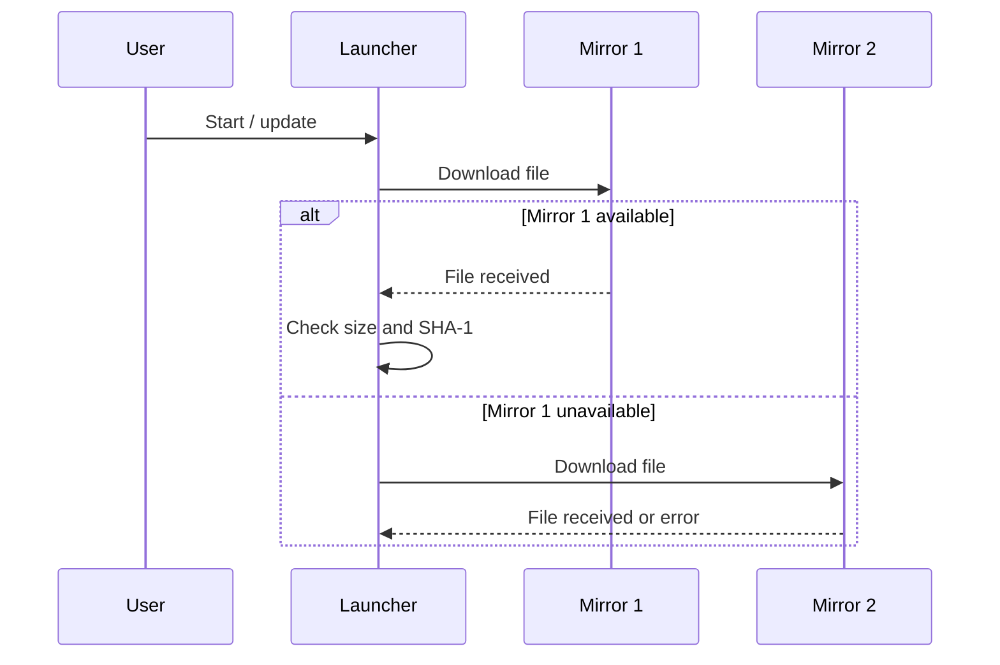
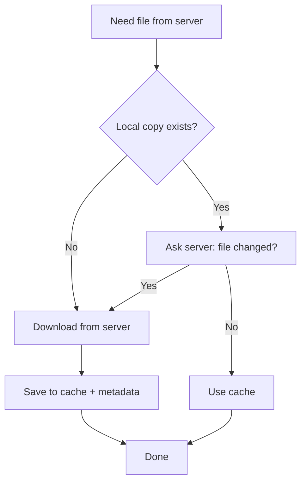
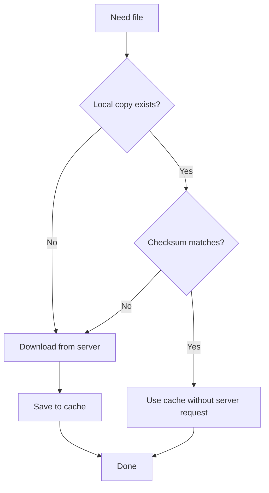
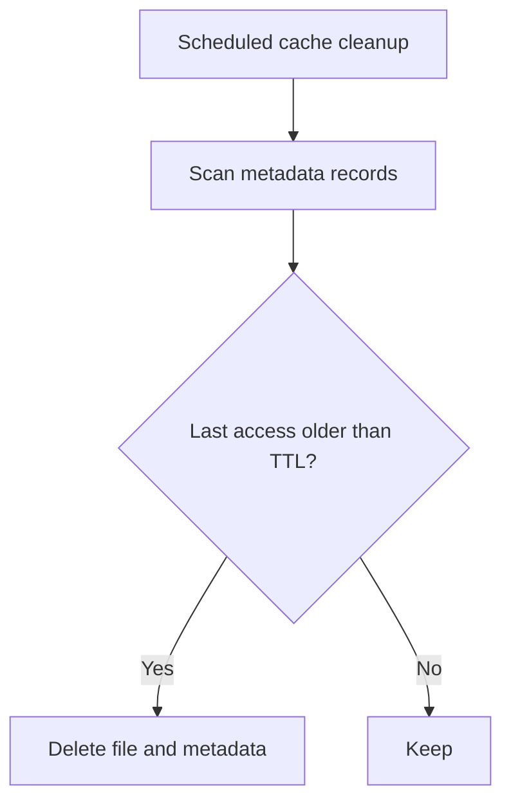
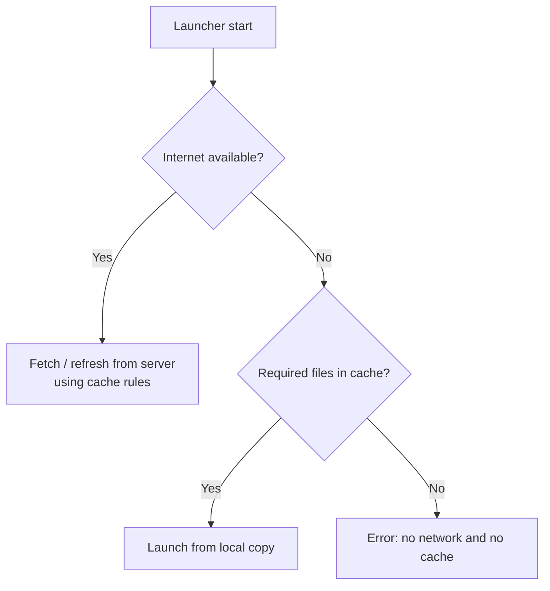
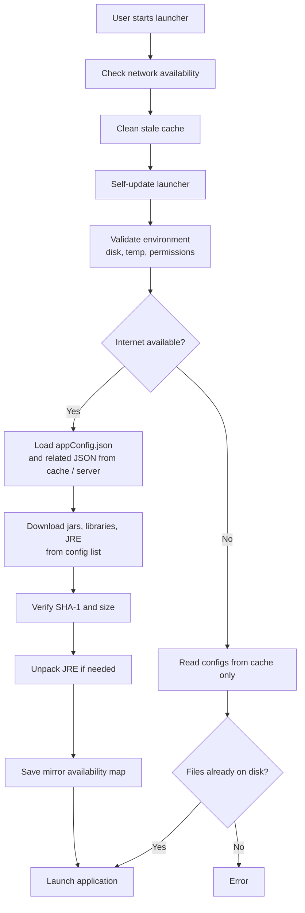

# http-download

[Russian version](README_RU.md)

This module handles **downloading files from a server** and **keeping local copies** of what was already fetched. The launcher uses it when updating an app: configs, JRE, jars, resources.

---

## Why it exists

### Multiple mirrors for the same file

A single file can be published at **several URLs** (mirrors). In config it looks like this:

```json
"appFileRepo": {
  "repositories": [
    "https://cdn.example.com/myapp/",
    "https://mirror.example.net/myapp/"
  ],
  "resources": [
    {
      "sha1": "3c7db385c07bb0482e918a236c33c4d3841380fa",
      "size": 5048893,
      "path": "myapp-1.0.jar",
      "relativeUrl": "1.0/myapp-1.0.jar"
    }
  ]
}
```

**Problem:** for some users one URL may be unreachable — blocking, CDN outage, slow route to a remote server. Without a fallback the app simply won't download.

**Solution:** the launcher tries mirrors **one by one**. If the first URL fails it automatically moves to the second, third, and so on until the file is downloaded.

Mirror order in config matters: **list the preferred URL first**. The rest are backups.

After a successful launch the launcher saves which URLs are currently reachable (`domainAvailabilityV1.json`). The running app can use this — for example to pick a working server for its own requests.

### Verifying the download

Each file in config has an expected **size** and **checksum (SHA-1)**. After download the launcher compares them with the file on disk. On mismatch the file is removed and the download is treated as failed (another mirror can be tried).

### Poor or missing internet

- On connection loss the request is **retried** several times.
- Downloaded files are **stored locally** — on the next run not everything must be re-fetched if the server file hasn't changed.
- With no internet at all the launcher can start the app from **locally cached** configs and files.

### Fast download of many files

Files are fetched **in parallel** (multiple threads). The launcher UI shows download progress.

### Unpacking and preparing files

After downloading archives (e.g. JRE) the launcher can **unpack** and prepare them for launch — no manual steps for the user.

### How mirror selection works



---

## Two modes of operation

### 1. Caching

Used mainly for **configs and small files** (e.g. `appConfig.json` and related JSON). The launcher saves the server response in the `cache` folder under the work directory. Each cached file has a sidecar record with last access time, checksum, and — when needed — server version hints.

On the next run the launcher **does not have to re-download everything** — it first checks for a suitable local copy.

#### Mode A: check freshness on the server

Used when it matters whether the **server file was updated** — e.g. when loading the current `appConfig.json`.

How it works:

1. No local copy yet → **download the full file**.
2. Copy exists → launcher sends a **light request** (without downloading the whole file) and compares the response with saved data.
3. Server file **unchanged** → use the local copy.
4. **Changed** → re-download and refresh cache.



#### Mode B: trust local copy

Used when the user **stays on the previous app version** and the launcher does not need to ask the server every time — only verify the local file is intact.

How it works:

1. No local copy → download from server.
2. Copy exists → launcher **compares checksum** on disk with the saved value. **No server request**.
3. Checksums match → use cache.
4. Mismatch (corrupted file) → re-download.



#### Stale cache cleanup

Files in cache that **haven't been used for a long time** are eventually removed. Retention is controlled by the launcher flag `-timeToLife` (seconds). Cleanup runs periodically, not on every start.



#### Offline launch

With no network the launcher **does not call the server** and tries to read configs from cache only. If required files are missing — launch fails.



#### JSON configs

If the server hosts JSON (e.g. dependency list), the launcher can turn it into app data right after reading from cache or from the server.

---

### 2. Application file download

A separate path for **large files**: jars, libraries, JRE, resources. The caching rules above do not apply here — files are downloaded from the config list, verified by size and SHA-1, and unpacked when needed. Mirrors are tried the same way as in the diagram above.

---

## Server requirements

For stable downloads and caching the HTTP server should support:

| Capability | Purpose |
|---|---|
| File download (GET) | Main download |
| Check without full download (HEAD) | Detect server-side changes (caching mode A) |
| Resume (Accept-Ranges) | Continue interrupted download of large files |

---

## Examples

### What happens when the launcher starts

The user starts the launcher. http-download is involved when loading configs and files:



**Steps in short:**

1. **Network check** — is there internet, which URLs respond.
2. **Cache cleanup** — remove long-unused files.
3. **Configs** — `appConfig.json` and nested JSON via cache (mode A or B above).
4. **App files** — jars, dependencies, JRE in parallel; mirrors tried per file.
5. **Verification** — size and SHA-1 after download.
6. **Launch** — start the app and pass mirror availability info.

---

### Demo tests (http-download)

Class `HttpDownloadExamplesTest` — scenarios from this README. Each test name describes what it shows.

| Test | What it demonstrates |
|---|---|
| `example_cacheModeA_reusesFileAfterHeadCheck` | Mode A: repeat config fetch — no full re-download, server freshness check |
| `example_cacheModeB_usesLocalCopyWithoutServer` | Mode B: repeat fetch — local copy, no server call |
| `example_mirrorFailover_usesWorkingRepository` | First mirror down — JSON from second |
| `example_downloadFile_validatesChecksumAfterDownload` | File download from config + SHA-1 check |
| `example_downloadFile_usesSecondMirrorWhenFirstFails` | File download via backup mirror |

Run:

```bash
mvn test -pl http-download -Dtest=HttpDownloadExamplesTest
```

Tests start a local HTTP server (MockServer) — no real external server required.

---

### Caching tests — `GsonServiceImplTest1`

File: `http-download/src/test/java/by/gdev/http/head/cache/GsonServiceImplTest1.java`

JSON download and cache behavior.

| Test | What it checks |
|---|---|
| `test1` | Mode A: JSON downloaded and parsed to Java object |
| `test2` | Mode B: same with trusted local copy |
| `test3` | Error when file missing on server |
| `test4` | Error when domain does not exist |
| `test5Timeout` | Error on unreachable server (timeout) |
| `test7` | Mirrors: bad domain skipped, data from working one |
| `test8` | Request without saving to cache — server response only |

Run:

```bash
mvn test -pl http-download -Dtest=GsonServiceImplTest1
```

---

### File download test — `DownloadTest`

File: `starter-core/src/test/java/by/gdev/core/DownloadTest.java`

Full flow: **JSON file list first**, then **parallel jar download**.

| Test | What it checks |
|---|---|
| `test1` | Load dependency list from JSON and start download; can cancel |
| `test2` | Cannot start second download while first is running |

Test config: `starter-core/src/test/resources/dependencies.json` — example `repositories` + `resources` structure.

Run:

```bash
mvn test -pl starter-core -Dtest=DownloadTest
```

---

### How examples map to a real launch

| Launcher step | What happens | Example test |
|---|---|---|
| Load `appConfig.json` | JSON via cache, mode A | `GsonServiceImplTest1.test1`, `HttpDownloadExamplesTest.example_cacheModeA_*` |
| User stays on old version | JSON via cache, mode B | `GsonServiceImplTest1.test2`, `HttpDownloadExamplesTest.example_cacheModeB_*` |
| First mirror unavailable | Switch to second | `GsonServiceImplTest1.test7`, `HttpDownloadExamplesTest.example_mirrorFailover_*` |
| Download jars and libraries | JSON list → parallel download | `DownloadTest.test1` |
| Post-download check | SHA-1 and size | `HttpDownloadExamplesTest.example_downloadFile_validatesChecksumAfterDownload` |
