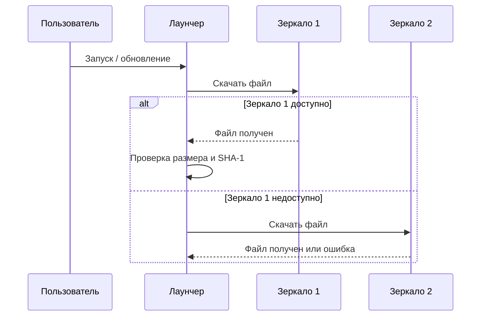
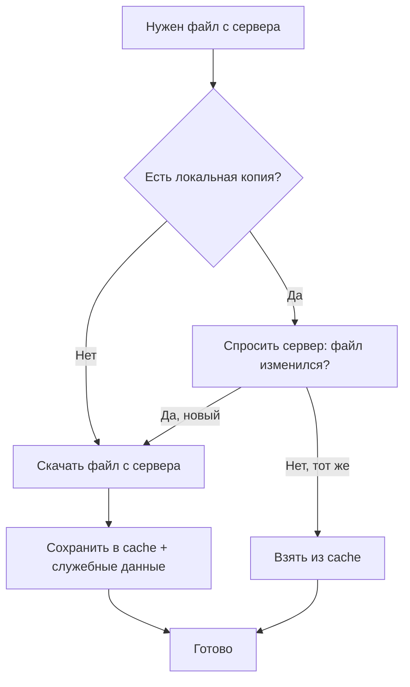
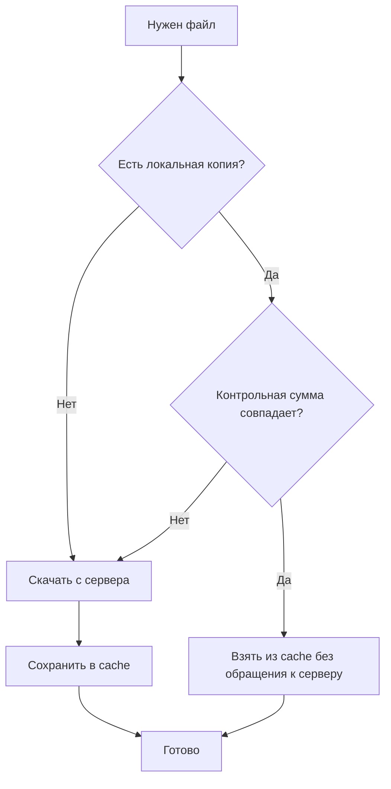
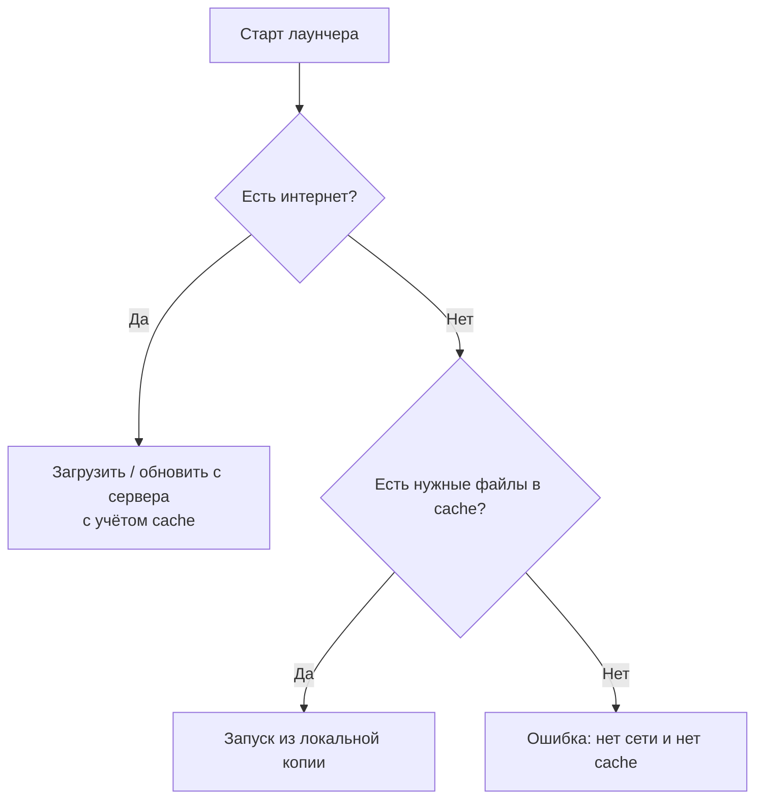
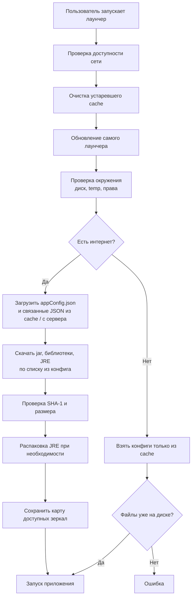

# http-download

[English version](README.md)

Модуль отвечает за **загрузку файлов с сервера** и **локальное хранение** того, что уже скачано. Используется лаунчером при обновлении приложения: конфиги, JRE, jar-файлы, ресурсы.

---

## Зачем это нужно

### Несколько зеркал одного и того же файла

На сервере один файл может лежать сразу на **нескольких адресах** (зеркалах). В конфиге это выглядит так:

```json
"appFileRepo": {
  "repositories": [
    "https://cdn.example.com/myapp/",
    "https://mirror.example.net/myapp/"
  ],
  "resources": [
    {
      "sha1": "3c7db385c07bb0482e918a236c33c4d3841380fa",
      "size": 5048893,
      "path": "myapp-1.0.jar",
      "relativeUrl": "1.0/myapp-1.0.jar"
    }
  ]
}
```

**Проблема:** у части пользователей один адрес может не открываться — блокировка, сбой CDN, медленный канал до зарубежного сервера. Без запасного варианта приложение просто не скачается.

**Решение:** лаунчер пробует зеркала **по очереди**. Если первый адрес недоступен — автоматически переходит ко второму, третьему и т.д., пока файл не загрузится.

Порядок зеркал в конфиге имеет значение: **первым указывайте тот адрес, который должен использоваться в обычной ситуации**. Остальные — запасные.

После успешного запуска лаунчер сохраняет информацию о том, какие адреса сейчас доступны (`domainAvailabilityV1.json`). Эту информацию можно передать в само приложение — например, чтобы оно тоже обращалось к рабочему серверу, а не к недоступному.

### Проверка, что файл скачался правильно

К каждому файлу в конфиге привязаны **размер** и **контрольная сумма (SHA-1)**. После загрузки лаунчер сверяет их с фактическим файлом на диске. Если что-то не совпало — файл удаляется и загрузка считается неудачной (можно попробовать другое зеркало).

### Работа при плохом или отсутствующем интернете

- При обрыве соединения запрос **повторяется** несколько раз.
- Уже скачанные файлы **сохраняются локально** — при следующем запуске не обязательно качать всё заново, если файл на сервере не менялся.
- Если интернета нет совсем, лаунчер может запустить приложение **из локальной копии** конфигов и файлов, скачанных ранее.

### Быстрая загрузка большого числа файлов

Файлы качаются **параллельно** (несколько потоков). В интерфейсе лаунчера отображается прогресс загрузки.

### Распаковка и подготовка файлов

После загрузки архивов (например, JRE) лаунчер может **распаковать** их и подготовить к запуску — без ручных действий пользователя.

### Как выбирается зеркало



---

## Два режима работы модуля

### 1. Кэширование

Используется в основном для **конфигов и небольших файлов** (например, `appConfig.json` и связанные JSON). Лаунчер сохраняет ответ сервера в папку `cache` рабочей директории. Рядом с каждым файлом лежит служебная запись с датой последнего обращения, контрольной суммой и — при необходимости — данными с сервера о версии файла.

При повторном запуске лаунчер **не обязан заново скачивать всё с нуля** — сначала смотрит, есть ли подходящая локальная копия.

#### Режим A: с проверкой актуальности на сервере

Применяется, когда важно знать, **обновился ли файл на сервере** — например, при загрузке актуального `appConfig.json`.

Как это работает:

1. Если локальной копии ещё нет — файл **скачивается целиком**.
2. Если копия есть — лаунчер делает **лёгкий запрос к серверу** (без скачивания всего файла) и сравнивает ответ с сохранёнными данными.
3. Если файл на сервере **не менялся** — используется локальная копия.
4. Если **изменился** — файл скачивается заново и кэш обновляется.



#### Режим B: доверие локальной копии

Применяется, когда пользователь **остался на прежней версии** приложения и лаунчеру не нужно каждый раз сверяться с сервером — достаточно убедиться, что локальный файл не повреждён.

Как это работает:

1. Если локальной копии нет — файл скачивается с сервера.
2. Если копия есть — лаунчер **сверяет контрольную сумму** файла на диске с сохранённой. Запрос к серверу **не отправляется**.
3. Если суммы совпали — файл берётся из cache.
4. Если не совпали (файл повреждён) — скачивается заново.



#### Очистка устаревшего cache

Файлы в cache, к которым **давно не обращались**, со временем удаляются. Срок хранения задаётся параметром лаунчера `-timeToLife` (в секундах). Очистка запускается периодически, не при каждом старте.


#### Запуск без интернета

Если сеть недоступна, лаунчер **не обращается к серверу** и пытается прочитать конфиги только из cache. Если нужных файлов там нет — запуск невозможен.



#### JSON-конфиги

Если на сервере лежит JSON (например, описание зависимостей), лаунчер может сразу превратить его в данные для приложения — после получения из cache или с сервера.

---

### 2. Загрузка файлов приложения

Отдельный режим для **крупных файлов**: jar, библиотеки, JRE, ресурсы. Здесь cache в описанном выше смысле не используется — файлы скачиваются по списку из конфига, проверяются по размеру и SHA-1, при необходимости распаковываются. Зеркала перебираются так же, как в схеме выше.

---

## Что нужно от сервера

Чтобы загрузка и кэш работали стабильно, HTTP-сервер должен поддерживать:

| Возможность | Зачем |
|---|---|
| Скачивание файла (GET) | Основная загрузка |
| Проверка без скачивания (HEAD) | Понять, изменился ли файл на сервере (режим A кэширования) |
| Докачка (Accept-Ranges) | Продолжить прерванную загрузку больших файлов |

---

## Примеры работы

### Что происходит при запуске лаунчера

Пользователь запускает лаунчер. Дальше — цепочка шагов, в которой http-download участвует на этапах загрузки конфигов и файлов:



**Кратко по шагам:**

1. **Проверка сети** — лаунчер узнаёт, есть ли интернет и какие адреса отвечают.
2. **Очистка cache** — удаляются давно неиспользуемые файлы.
3. **Конфиги** — `appConfig.json` и вложенные JSON загружаются через кэш (режим A или B, см. выше).
4. **Файлы приложения** — jar, зависимости, JRE качаются параллельно; для каждого файла перебираются зеркала.
5. **Проверка** — после загрузки сверяются размер и SHA-1.
6. **Запуск** — лаунчер стартует приложение и передаёт ему информацию о доступных зеркалах.

---

### Демонстрационные тесты (http-download)

Класс `HttpDownloadExamplesTest` — наглядные сценарии из этого README. Каждый тест назван по тому, что он показывает.

| Тест | Что показывает |
|---|---|
| `example_cacheModeA_reusesFileAfterHeadCheck` | Режим A: повторный запрос конфига — файл не качается заново, актуальность проверяется на сервере |
| `example_cacheModeB_usesLocalCopyWithoutServer` | Режим B: повторный запрос — берётся локальная копия без обращения к серверу |
| `example_mirrorFailover_usesWorkingRepository` | Первое зеркало недоступно — JSON получен со второго |
| `example_downloadFile_validatesChecksumAfterDownload` | Скачивание файла по конфигу и проверка SHA-1 |
| `example_downloadFile_usesSecondMirrorWhenFirstFails` | Скачивание файла через запасное зеркало |

Тесты поднимают локальный HTTP-сервер (MockServer) — реальный внешний сервер не нужен.

---

### Тесты кэширования — `GsonServiceImplTest1`

Файл: `http-download/src/test/java/by/gdev/http/head/cache/GsonServiceImplTest1.java`

Проверяет загрузку JSON с сервера и работу кэша.

| Тест | Что проверяет |
|---|---|
| `test1` | Режим A: JSON скачивается и превращается в Java-объект |
| `test2` | Режим B: то же, но с доверием локальной копии |
| `test3` | Ошибка, если файла нет на сервере |
| `test4` | Ошибка, если домен не существует |
| `test5Timeout` | Ошибка при недоступном сервере (таймаут) |
| `test7` | Зеркала: недоступный домен пропускается, данные приходят с рабочего |
| `test8` | Запрос без сохранения в cache — только ответ сервера |

---

### Тест загрузки файлов — `DownloadTest`

Файл: `starter-core/src/test/java/by/gdev/core/DownloadTest.java`

Показывает полный сценарий: **сначала JSON со списком файлов**, затем **многопоточная загрузка** jar-ов из этого списка.

| Тест | Что проверяет |
|---|---|
| `test1` | Загрузка списка зависимостей из JSON и старт скачивания; можно прервать загрузку |
| `test2` | Нельзя запустить вторую загрузку, пока первая ещё идёт |

Конфиг для теста лежит в `starter-core/src/test/resources/dependencies.json` — там же пример структуры `repositories` + `resources`.

---

### Как связаны примеры с реальным запуском

| Этап лаунчера | Что происходит | Какой тест это иллюстрирует |
|---|---|---|
| Загрузка `appConfig.json` | JSON через cache, режим A | `GsonServiceImplTest1.test1`, `HttpDownloadExamplesTest.example_cacheModeA_*` |
| Пользователь остался на старой версии | JSON через cache, режим B | `GsonServiceImplTest1.test2`, `HttpDownloadExamplesTest.example_cacheModeB_*` |
| Недоступно первое зеркало | Переход ко второму | `GsonServiceImplTest1.test7`, `HttpDownloadExamplesTest.example_mirrorFailover_*` |
| Скачивание jar и библиотек | Список из JSON → параллельная загрузка | `DownloadTest.test1` |
| Проверка после скачивания | SHA-1 и размер | `HttpDownloadExamplesTest.example_downloadFile_validatesChecksumAfterDownload` |
